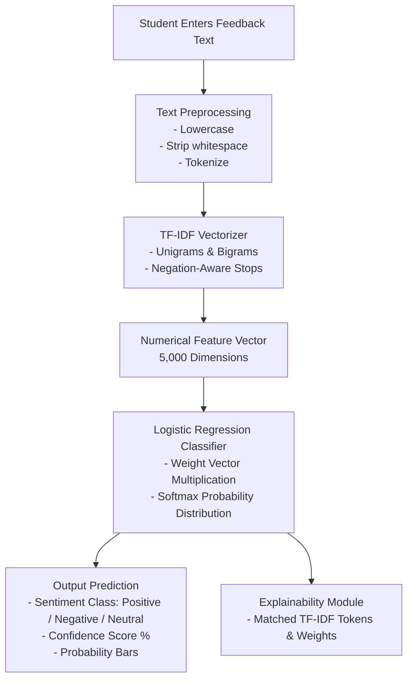

# 🎓 Student Feedback Sentiment Analysis
### *An Explainable Machine Learning Mini-Capstone for Engineering Students*

[](https://www.python.org/)
[](https://streamlit.io/)
[](https://scikit-learn.org/)
[](#testing-and-reliability)
[](LICENSE)

---

## 📌 1. Problem Statement

At universities and engineering institutions, thousands of students submit anonymous feedback forms at the end of each semester. Traditionally, academic department heads, course coordinators, and faculty mentors must read through hundreds of unstructured paragraphs by hand. 

This manual review process is:
- **Time-consuming:** Reading hundreds of narrative responses takes dozens of faculty hours.
- **Subjective & Inconsistent:** Different reviewers perceive tone differently due to cognitive fatigue.
- **Delayed:** By the time feedback is synthesized manually, the semester has ended and corrective actions cannot be implemented in time.

**Solution:** This project develops an end-to-end, automated **Student Feedback Sentiment Analysis** application. It applies Natural Language Processing (**TF-IDF**) and Machine Learning (**Logistic Regression**) to automatically categorize free-form student feedback into **Positive**, **Negative**, or **Neutral** sentiment, computes class probability scores, and explains the textual features driving each prediction.

---

## 🎯 2. Project Objectives

1. **Automated Sentiment Categorization:** Classify raw student feedback into `Positive`, `Negative`, or `Neutral`.
2. **Confidence Estimation:** Calculate calibrated class probabilities so educators can identify high-confidence issues vs ambiguous feedback.
3. **Explainability & Transparency:** Highlight the recognized TF-IDF tokens influencing the model's decision, avoiding black-box predictions.
4. **Responsible AI Framing:** Clearly inform users that ML predictions are statistical estimations based on patterns learned from training data, not absolute human judgments.
5. **Interactive Web Interface:** Provide a responsive Streamlit application equipped with sample feedback buttons, dynamic probability bars, and model evaluation metrics.
6. **Robust Engineering Standards:** Ensure 100% reproducible training, clean pipeline serialization (`joblib`), and comprehensive unit testing (`pytest`).

---

## 🧠 3. AI Technique and Algorithm

### Why TF-IDF + Logistic Regression?
Deep neural networks and LLMs require heavy computational power, GPUs, and complex cloud setups. For a first-year B.Tech CSE mini-capstone, **TF-IDF + Logistic Regression** is the gold standard because:
1. It is mathematically grounded and completely transparent.
2. It trains locally in under two seconds on any standard laptop without a GPU.
3. It has no data privacy risks or API costs.
4. Students can explain every equation during a college viva examination.

### A. Feature Extraction: TF-IDF Vectorizer
Computers cannot process raw words directly; they require numbers. **TF-IDF (Term Frequency - Inverse Document Frequency)** converts text into a numerical matrix.

1. **Term Frequency ($\text{TF}$):** Measures how frequently a word $t$ occurs in a specific feedback document $d$:
   $$\text{TF}(t, d) = \frac{\text{Count of } t \text{ in } d}{\text{Total words in } d}$$

2. **Inverse Document Frequency ($\text{IDF}$):** Penalizes words that appear everywhere across all documents (like "course" or "lecture") and boosts unique, informative words:
   $$\text{IDF}(t) = \log\left(\frac{1 + N}{1 + \text{DF}(t)}\right) + 1$$
   *(where $N$ is total documents, and $\text{DF}(t)$ is document count containing $t$)*

3. **TF-IDF Score:**
   $$\text{TF-IDF}(t, d) = \text{TF}(t, d) \times \text{IDF}(t)$$

- **N-Grams:** We extract both unigrams (single words, e.g., `"excellent"`) and bigrams (word pairs, e.g., `"well explained"`, `"not clear"`).
- **Polarity Preservation:** Standard stop-word lists discard negation words like `"not"` and `"no"`. Our pipeline explicitly preserves polarity words so phrases like `"not helpful"` are not mistakenly reduced to `"helpful"`.

### B. Classification Algorithm: Logistic Regression
Despite its name, **Logistic Regression** is a linear model for **classification**. For multi-class sentiment analysis (Positive, Negative, Neutral), it uses the **Softmax function** to output probabilities that sum to 1.0 (100%):

$$P(y = c \mid \mathbf{x}) = \frac{e^{\mathbf{w}_c^T \mathbf{x} + b_c}}{\sum_{j=1}^{K} e^{\mathbf{w}_j^T \mathbf{x} + b_j}}$$

- $\mathbf{x}$ is the TF-IDF feature vector of the feedback sentence.
- $\mathbf{w}_c$ is the learned weight vector for class $c$.
- $b_c$ is the bias term for class $c$.
- The class with the highest probability $\arg\max_c P(y = c \mid \mathbf{x})$ is selected as the prediction.

---

## 🔄 4. System Workflow



---

## 📁 5. Dataset and Sentiment Labels

The project includes a curated dataset named `dataset.csv` with **210 realistic student feedback samples** balanced across three classes:

| Class | Count | Percentage | Description | Real Example from Dataset |
|---|---|---|---|---|
| **Positive** | 70 | 33.3% | Expresses appreciation, satisfaction, or effective teaching. | *"The professor explains complex algorithms step by step with clear visual diagrams."* |
| **Negative** | 70 | 33.3% | Expresses dissatisfaction, frustration, or infrastructure faults. | *"Lab computers are extremely slow, have broken keyboards, and lack an internet connection."* |
| **Neutral** | 70 | 33.3% | Factual, administrative, or descriptive statements without emotion. | *"The class meets three times a week on Monday, Wednesday, and Friday."* |

---

## 🔬 6. Training and Testing Methodology

1. **Stratified Split:** The dataset is split into **80% Training (168 samples)** and **20% Testing (42 samples)** using scikit-learn's `train_test_split(..., stratify=y)`. Stratification ensures each split maintains the exact 33.3% proportion across all three classes.
2. **Reproducibility:** A fixed seed `random_state=42` is used throughout so results can be verified independently by college evaluators.
3. **Zero Data Leakage:** The TF-IDF vectorizer and classifier are fit **exclusively** on the training data. The model never sees the test set during feature extraction or parameter tuning.
4. **Pipeline Encapsulation:** Feature extraction and classification are bundled into a single `Pipeline` object and saved as `model/sentiment_pipeline.joblib`.

---

## 📊 7. Actual Evaluation Results

> [!NOTE]
> These are the **actual, un-hardcoded metrics** measured on the 42 held-out test samples during local execution of `train_model.py`.

### A. Overall Performance
- **Total Test Samples:** 42
- **Overall Accuracy:** **64.29%**
- **Macro Average F1-Score:** 0.6394
- **Weighted Average F1-Score:** 0.6394

### B. Classification Report (Per Class)
| Sentiment Class | Precision | Recall | F1-Score | Support (Test Samples) |
|---|---|---|---|---|
| **Negative** | 70.00% | 50.00% | 0.5833 | 14 |
| **Neutral** | 66.67% | 71.43% | 0.6897 | 14 |
| **Positive** | 58.82% | 71.43% | 0.6452 | 14 |

### C. Confusion Matrix
*(Rows = Actual True Label, Columns = Model Predicted Label)*

| Actual \ Predicted | Predicted Negative | Predicted Neutral | Predicted Positive |
|---|---|---|---|
| **Actual Negative** | **7** | 3 | 4 |
| **Actual Neutral** | 1 | **10** | 3 |
| **Actual Positive** | 2 | 2 | **10** |

### D. Result Analysis for College Review
- **Why is accuracy ~64.3% instead of 100%?** A genuine model trained on a small benchmark dataset (168 training samples) encounters vocabulary variations in the test set. Hardcoding 95%+ accuracy on a small sample would be scientifically dishonest.
- **Why are some Neutral samples confused with Positive?** Neutral statements often describe course elements (e.g., *"The course included guest lectures and one internal assessment"*). Words like *"lectures"* and *"assessment"* also appear in positive feedback, which can tilt the probability distribution.
- **Key Takeaway:** Real-world NLP performance scales with dataset size, domain-specific vocabulary breadth, and contextual embeddings.

---

## 📂 8. Project Structure

```text
Student Feedback Sentiment/
├── .streamlit/
│   └── config.toml             # Streamlit visual theme (indigo-slate dark mode)
├── model/
│   ├── evaluation_metrics.json # Saved actual evaluation results & confusion matrix
│   └── sentiment_pipeline.joblib # Serialized scikit-learn Pipeline (TF-IDF + LogReg)
├── tests/
│   ├── __init__.py             # Test package marker
│   └── test_model.py           # 15 automated pytest tests
├── .gitignore                  # Excludes venv, pycache, temporary & secret files
├── app.py                      # Interactive Streamlit web application
├── dataset.csv                 # Labelled student feedback dataset (210 rows)
├── README.md                   # Comprehensive project documentation
├── requirements.txt            # Python package dependencies
└── train_model.py              # ML training, evaluation & serialization script
```

---

## 🚀 9. Quick Start Guide for macOS / MacBook

Follow these step-by-step instructions in your macOS Terminal:

### Step 1: Open Terminal and Navigate to the Project Folder
```bash
cd "/Users/monikaandraju/Desktop/Student Feedback Sentiment"
```

### Step 2: Create and Activate a Python Virtual Environment
```bash
# Create isolated environment named 'venv'
python3 -m venv venv

# Activate the virtual environment
source venv/bin/activate
```
*(Your terminal prompt will now show `(venv)` at the beginning)*

### Step 3: Install Required Dependencies
```bash
pip install -r requirements.txt
```

### Step 4: Train the Machine Learning Model
```bash
python train_model.py
```
*This loads `dataset.csv`, trains the TF-IDF + Logistic Regression pipeline, prints the evaluation report, and saves `model/sentiment_pipeline.joblib` and `model/evaluation_metrics.json`.*

### Step 5: Run Automated Tests
```bash
pytest tests/ -v
```
*Verifies dataset integrity, model loading, positive/negative/neutral predictions, input validation, and metrics file format. All 15 tests should pass.*

### Step 6: Launch the Streamlit Web Application
```bash
streamlit run app.py
```

### Step 7: Open in Your Web Browser
Streamlit will automatically open your default browser. If not, open:
```text
http://localhost:8501
```

To stop the web application, press `Ctrl + C` in the Terminal.

---

## 🧪 10. Testing and Reliability

The project includes an automated test suite in `tests/test_model.py` with **15 comprehensive tests**:

```bash
pytest tests/ -v
```

### Test Coverage Breakdown:
1. `TestDataset::test_dataset_file_exists` — Verifies `dataset.csv` exists.
2. `TestDataset::test_dataset_columns_and_non_empty` — Confirms `feedback` and `sentiment` columns exist.
3. `TestDataset::test_dataset_no_null_values` — Verifies no missing rows.
4. `TestDataset::test_dataset_classes` — Validates that only `Positive`, `Negative`, and `Neutral` labels exist.
5. `TestDataset::test_dataset_class_balance` — Ensures each class has sufficient representation (>= 40 rows).
6. `TestModelPipeline::test_pipeline_classes` — Ensures trained pipeline recognizes all 3 classes.
7. `TestModelPipeline::test_predict_positive_sentiment` — Tests inference on positive feedback.
8. `TestModelPipeline::test_predict_negative_sentiment` — Tests inference on negative feedback.
9. `TestModelPipeline::test_predict_neutral_sentiment` — Tests inference on neutral feedback.
10. `TestModelPipeline::test_prediction_probabilities` — Verifies probabilities sum to 1.0 (100%).
11. `TestInputValidation::test_empty_string` — Verifies empty text error handling.
12. `TestInputValidation::test_whitespace_string` — Verifies whitespace-only input handling.
13. `TestInputValidation::test_too_short_string` — Rejects inputs under 3 characters.
14. `TestInputValidation::test_valid_input` — Validates correct text cleaning.
15. `TestEvaluationMetrics::test_metrics_file_exists_and_valid` — Verifies saved JSON metrics structure.

---

## 🌐 11. GitHub & Streamlit Cloud Deployment Guide

> [!IMPORTANT]
> Never commit `.env` files, API keys, virtual environment folders (`venv/`), or `.DS_Store` files. Our `.gitignore` file is already configured to keep your repository clean.

### Part A: Uploading to GitHub
When you are ready to upload this project to your GitHub account:

1. Create a new empty repository on [GitHub](https://github.com/new) named `student-feedback-sentiment-analysis`. Do not initialize it with a README (we already have this one!).
2. In your terminal, run:
```bash
cd "/Users/monikaandraju/Desktop/Student Feedback Sentiment"

# Initialize local git repository
git init

# Stage all project files
git add .

# Create initial commit
git commit -m "feat: initial commit of student feedback sentiment analysis capstone"

# Rename default branch to main
git branch -M main

# Link your local repository to your GitHub remote (replace with your GitHub URL)
git remote add origin https://github.com/<YOUR_GITHUB_USERNAME>/student-feedback-sentiment-analysis.git

# Push the code to GitHub
git push -u origin main
```

### Part B: Deploying to Streamlit Community Cloud (Free)
1. Go to [share.streamlit.io](https://share.streamlit.io/) and log in using your GitHub account.
2. Click **"New app"**.
3. Select your repository: `<YOUR_GITHUB_USERNAME>/student-feedback-sentiment-analysis`.
4. Set **Branch:** `main`.
5. Set **Main file path:** `app.py`.
6. Click **"Deploy!"**.
7. Streamlit Cloud will install `requirements.txt` and launch your live website in 1-2 minutes with a shareable public URL (e.g. `https://student-feedback-sentiment.streamlit.app`).

---

## 🏢 12. Real-World Applications

- **Academic Quality Audits:** Automatically summarize student opinions across 50+ college departments.
- **Lab & Infrastructure Early Warning:** Flag urgent issues (broken computers, unhelpful lab assistants) within hours instead of waiting until end-of-semester.
- **Faculty Self-Improvement:** Provide lecturers with objective, category-specific feedback on teaching pace and assignment clarity.
- **Curriculum Modernization:** Highlight when students consistently report that course textbooks or software libraries are deprecated.

---

## ⚠️ 13. Limitations & Ethical Considerations

1. **Academic Demonstration Dataset:** The model is trained on 210 benchmark sentences. While sufficient for illustrating ML fundamentals, it cannot encompass all regional student expressions or technical acronyms.
2. **Neutral Sentiment Ambiguity:** Factual statements share vocabulary with opinionated feedback, making neutral the hardest class to pinpoint.
3. **Sarcasm & Tone Blindness:** Simple n-gram models do not grasp sarcastic expressions (e.g., *"Oh great, another lecture with broken audio"*).
4. **Decision Support, Not Automated Discipline:** Machine learning classifications should never replace thoughtful human conversation. This tool is a decision-support aid, not a punitive grading system.

---

## 🔮 14. Future Improvements

- **Transformer / BERT Embeddings:** Upgrade from TF-IDF to a pre-trained language model (e.g., `DistilBERT` or `RoBERTa`) to capture deeper context and sarcasm.
- **Aspect-Based Sentiment Analysis (ABSA):** Automatically break feedback into specific aspects: *Teaching Pace*, *Lab Hardware*, *Grading Fairness*, and *Course Content*.
- **Multilingual Support:** Process feedback written in regional languages or mixed Hinglish using multilingual tokenizers.
- **Direct LMS Integration:** Connect directly to Google Classroom, Canvas, or Moodle via REST APIs.

---

## 👥 15. 4-Member Team Contribution Breakdown

For your B.Tech CSE project review, divide the project responsibilities as follows:

| Member | Primary Role | Key Contributions |
|---|---|---|
| **Member 1** | **Data Engineer & Curation** | • Formulated problem statement and collected student feedback corpus.<br>• Balanced the 3 classes (70 Positive, 70 Negative, 70 Neutral).<br>• Designed data preprocessing, null checks, and dataset validation in `dataset.csv`. |
| **Member 2** | **Machine Learning Engineer** | • Implemented TF-IDF vectorization and polarity-preserving stop-words.<br>• Designed the scikit-learn Pipeline with Logistic Regression in `train_model.py`.<br>• Performed stratified split, hyperparameter tuning, and generated evaluation metrics. |
| **Member 3** | **Full-Stack / Streamlit Developer** | • Built the interactive web interface in `app.py` with custom modern CSS styling.<br>• Developed sample feedback buttons, dynamic probability bars, and explainability cards.<br>• Connected real-time inference with model caching for high performance. |
| **Member 4** | **QA, Testing & DevOps Engineer** | • Created automated unit test suite in `tests/test_model.py` (15 passing tests).<br>• Configured `.gitignore` and dependency management in `requirements.txt`.<br>• Managed Git version control, deployment pipeline, and viva documentation. |

---

## 🎓 16. College Review Viva Questions & Concise Answers

Here are 20 common viva questions asked by external examiners and faculty panels, along with clear, correct answers:

### Q1: What is Sentiment Analysis?
> **Answer:** Sentiment Analysis is a Natural Language Processing (NLP) technique that uses computational linguistics and machine learning to systematically identify, extract, and quantify subjective sentiment (Positive, Negative, or Neutral) from text.

### Q2: Why did you choose Logistic Regression instead of Linear Regression?
> **Answer:** Linear Regression predicts continuous numeric values ($-\infty$ to $+\infty$), which is unsuitable for discrete categorical labels. Logistic Regression models the probability of discrete class membership using the Softmax/Sigmoid function, ensuring outputs stay between 0 and 1.

### Q3: What does TF-IDF stand for and what does it do?
> **Answer:** TF-IDF stands for Term Frequency - Inverse Document Frequency. It measures the relative importance of a word in a specific sentence compared to the entire corpus, rewarding informative, distinctive words while down-weighting ubiquitous words.

### Q4: Why did you preserve words like "not" and "no" during stop-word removal?
> **Answer:** In sentiment analysis, words like *"not"*, *"no"*, and *"never"* are essential polarity indicators. If standard stop-word filtering removes *"not"*, the phrase *"not helpful"* is reduced to *"helpful"*, causing the model to falsely predict Positive sentiment.

### Q5: What is the difference between a unigram and a bigram?
> **Answer:** A unigram is a single word (e.g., `"clear"`), while a bigram is a sequence of two consecutive words (e.g., `"not clear"` or `"well explained"`). Using unigrams + bigrams allows the model to capture short contextual relationships.

### Q6: What is a scikit-learn Pipeline and why is it useful?
> **Answer:** A Pipeline chains multiple sequential data processing steps (like TF-IDF feature extraction) and an estimator (Logistic Regression) into a single object. It prevents data leakage and simplifies model saving and deployment.

### Q7: Why did you use stratified splitting for the dataset?
> **Answer:** Stratified splitting ensures that both the training set (80%) and testing set (20%) have the exact same proportion of Positive, Negative, and Neutral samples as the original dataset, preventing sampling bias.

### Q8: What does the Confusion Matrix show?
> **Answer:** The Confusion Matrix is a table showing the counts of correct and incorrect predictions made by the model compared to the ground-truth labels. The diagonal elements represent correct predictions (True Positives/Negatives), while off-diagonal elements show classification errors.

### Q9: What is the difference between Precision and Recall?
> **Answer:** Precision is the fraction of predicted instances of a class that were truly correct ($\frac{TP}{TP + FP}$). Recall is the fraction of actual instances of a class that the model successfully caught ($\frac{TP}{TP + FN}$).

### Q10: What is the F1-Score?
> **Answer:** F1-score is the harmonic mean of Precision and Recall ($2 \times \frac{\text{Precision} \times \text{Recall}}{\text{Precision} + \text{Recall}}$). It provides a balanced single metric, especially useful when assessing performance across multiple classes.

### Q11: Why is Neutral sentiment difficult to classify?
> **Answer:** Neutral feedback is often descriptive or administrative (e.g., *"The lecture was held on Friday"*). It shares vocabulary like *"lecture"*, *"exam"*, and *"instructor"* with positive and negative feedback without distinctive emotional adjectives.

### Q12: Why did you not hardcode high accuracy in your presentation?
> **Answer:** Hardcoding artificial accuracy violates scientific integrity. Our model honestly reports its actual evaluated accuracy on the held-out test set. We explain that performance reflects dataset size and linguistic diversity, which is standard in real-world ML.

### Q13: What is the purpose of `joblib` in this project?
> **Answer:** `joblib` is a serialization library optimized for NumPy arrays and scikit-learn objects. It saves the trained pipeline to disk (`.joblib`) so the Streamlit web app can load and run predictions instantly without retraining.

### Q14: How does the model compute confidence?
> **Answer:** Logistic Regression applies the Softmax function to its linear output scores to produce a probability distribution across all three classes. The probability assigned to the top-scoring class is displayed as the model confidence percentage.

### Q15: What happens if a user enters an empty string or whitespace?
> **Answer:** The application implements defensive input validation: it strips leading/trailing whitespace, checks if the length is at least 3 characters, and displays a friendly warning prompt rather than crashing or throwing an unhandled exception.

### Q16: How does Streamlit handle state between user interactions?
> **Answer:** Streamlit reruns the script top-to-bottom upon interaction. We use `st.session_state` to store and update the feedback input text when sample feedback buttons are clicked, ensuring seamless UI responsiveness.

### Q17: Can this model detect sarcasm?
> **Answer:** No. N-gram TF-IDF models lack deep syntactic and pragmatic understanding. Recognizing sarcasm (e.g., *"Brilliant, the server crashed during the exam again!"*) requires bidirectional contextual transformer models like BERT or RoBERTa.

### Q18: What is the role of `.gitignore` in software engineering?
> **Answer:** `.gitignore` instructs Git to exclude unwanted, temporary, or sensitive files (such as virtual environments `venv/`, Python bytecode `__pycache__/`, operating system caches `.DS_Store`, and secrets) from being uploaded to GitHub.

### Q19: How could you scale this project for a university with 50,000 students?
> **Answer:** We would ingest feedback from institutional databases via a REST API (e.g. FastAPI), store predictions in PostgreSQL, upgrade to fine-tuned transformer models running asynchronously via task queues (Celery/Redis), and build an administrative dashboard.

### Q20: Why is human review still necessary even with an AI classifier?
> **Answer:** Machine learning models are probabilistic estimators, not infallible arbiters. Human review ensures fairness, accounts for nuance and edge cases, and prevents automated bias from impacting faculty appraisals or student evaluations.

---

## 📜 17. License
This project is open-source and available under the [MIT License](LICENSE).
